# Dialog

The dialog class can be used to show dialog windows with input controls/widgets on the
screen to get some data from the user.

Example:

```lua
local dlg = Dialog()
dlg:entry{ id="user_value", label="User Value:", text="Default User" }
dlg:button{ id="confirm", text="Confirm" }
dlg:button{ id="cancel", text="Cancel" }
dlg:show()
local data = dlg.data
if data.confirm then
  app.alert("The given value is '" .. data.user_value .. "'")
end
```

Almost all dialog functions return the same dialog object, so [method chaining](https://en.wikipedia.org/wiki/Method_chaining) can be used, e.g:

```lua
local data =
  Dialog():entry{ id="user_value", label="User Value:", text="Default User" }
          :button{ id="confirm", text="Confirm" }
          :button{ id="cancel", text="Cancel" }
          :show().data
if data.confirm then
  app.alert("The given value is '" .. data.user_value .. "'")
end
```
## Common Properties

Every widget (e.g `Dialog:button()`) has a few common properties:

```lua
Dialog:widget_type{
  id=string,
  label=string,
  labelalign=Align,
  focus=boolean,
  enabled=boolean,
  visible=boolean,
  hexpand=boolean,
  vexpand=boolean,
}
```

* `id`: The ID that identifies this widget, for use with [Dialog.data](#dialogdata), [Dialog:modify()](#dialogmodify), etc.
* `label`: Label on the left side of the widget.
* `labelalign`: The alignment of the `label`, an [Align](align.md#align) constant.
* `focus`: Focus the widget by when the dialog is shown (useful to focus a specific
  [entry](#dialogentry) or [button](#dialogbutton) when the dialog appears on the screen for the
  first time). The widget with the property set to `true` is focused. If all of the widgets have the property set to `false`/not specified, the first focusable widget will be focused.
* `enabled`: Enable or disable the widget, e.g disable a button from being pressed. Defaults to `true`.
* `visible`: Make the widget visible or hidden. Defaults to `true`.
* `hexpand`: Expand the widget horizontally (useful to make a [canvas](#dialogcanvas) with fixed size if we specify `hexpand=false`)
* `vexpand`: Expand the widget vertically (useful to make a [canvas](#dialogcanvas) with fixed size if we specify `vexpand=false`)

## Dialog()

```lua
local dlg = Dialog()
local dlg = Dialog(string)
local dlg = Dialog{
    title=string,
    autofit=Align,
    notitlebar=false,
    resizeable=false,
    parent=otherDialog,
    onclose=function,
    onresize=function,
}
```

Creates a new dialog. The dialog is hidden by default, so you have to call
[Dialog:show()](#dialogshow) to make it visible. The
constructor that receives a `string` will use that string as the title in the title bar 
of the dialog. The constructor that receives a table can include these properties:

* `title`: The title of the dialog. A string.
* `autofit`: How the widgets in the dialog will align when shown; accepts an [Align](align.md#align) constant value. See [Dialog.autofit](#dialogautofit).
* `resizeable`: Whether or not the dialog window is resizeable. A boolean.
* `notitlebar`: Whether or not the dialog window should have a titlebar. A boolean. If this is set to `false`, the dialog must be closed with a button or [`Dialog:close()`](#dialogclose).
* `parent`: The dialog's parent [dialog object](#dialog); useful for creating subdialogs "inside" a parent dialog (the parent dialog is blocked until the child dialog is closed).
* `onclose`: Callback function that is called when the dialog is closed.
* `onresize`: Callback function that is called when the dialog is resized.

Returns `nil` if there is no UI available (i.e. [app.isUIAvailable](app.md#appisuiavailable)  is `false`).

## Dialog.data

```lua
local dlg = Dialog()
local data = dlg.data
dlg.data = data
```

Gets/sets a key-value table with one field for each widget with a given `id`. 
Each key is a widget id, and the value is different depending on the type of widget the id belongs to:

* [button](#dialogbutton)/[check](#dialogcheck)/[radio](#dialogradio):
  The value is a `boolean` (true or
  false) if the button is selected or was used to close the dialog.
* [entry](#dialogentry)/[label](#dialoglabel): A string of text, the value from the widget's `text` property.
* [slider](#dialogslider): An integer, the value from the widget's `value` property.
* [number](#dialognumber): The widget's number value; depending on the widget's `decimals` property, this can be either an integer or a number.
* [combobox](#dialogcombobox): A string of the selected item; the value from the widget's `option` property.
* [color](#dialogcolor): A [Color](color.md#color).
* [shades](#dialogshades): A table with an array of [Colors](color.md#color) when `mode="sort"`.
* [file](#dialogfile): The widget's `filename` property, a string.
* [endtabs](#dialogendtabs): The `id` of the currently selected tab, a string.

It is important to keep in mind that while you can get values directly from the `Dialog.data` table (e.g `Dialog.data.id`), you can't set them directly (so doing `Dialog.data.id = value` won't work). Instead, you need to copy `Dialog.data` into a variable (`Dialog.data` returns a reference to a new table), set the property of that, and then set `Dialog.data` to the newly altered table:

```lua
local dlg = Dialog()
dlg:entry{id="textEntry"}

local data = dlg.data
data.textEntry = "Default Text"
dlg.data = data
```

## Dialog.bounds

```lua
local dlg = Dialog()
local bounds = dlg.bounds
dlg.bounds = Rectangle(x, y, bounds.width, bounds.height)
```

Gets or sets the position and size (a [rectangle](rectangle.md#rectangle)) of
the dialog. This can be useful to align several dialog that must be
shown in the same *xy*-position, or to open a dialog in the same location after it was closed (using [Dialog:show()](#dialogshow)).

## Dialog.autofit

```lua
local autofit = dlg.autofit
dlg.autofit = autofit
```

Gets or sets the dialog autofit, as an [Align](align.md#align) object. The setting will only visually take effect on the dialog after a [`Dialog:modify()`](#dialogmodify). When set, the dialog window will resize itself, anchoring at the specified value (eg. when autofitting with `Align.LEFT | Align.TOP`, the dialog bounds will shrink to the minimum size anchored at the top left of the dialog).

## Dialog.sizeHint

```lua
local sizeHint = dlg.sizeHint
```

Gets the minimum size (without cutoff) of the dialog window, as a [Size](size.md#Size).

## Dialog:button()

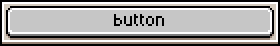

```lua
local dlg = Dialog()
dlg:button{
  id=string,
  label=string,
  text=string,
  selected=boolean,
  focus=boolean,
  onclick=function
}
```

Creates a button.

Arguments (table fields):

* `id`: Identifier for this button. [Dialog.data](#dialogdata) will contain a field
  for each widget with an `id`.
* `label`: Text label on the left side of the control.
* `text`: Text displayed on the button.
* `selected`: True in case that you want to show the button checked by default.
* `focus`: Focus this button by default or when the Enter key is pressed in a [text entry](#dialogentry) field.
* `onclick`: Function to be called when the button is pressed. When omitted, clicking the button closes its Dialog, as if [Dialog:close()](#dialogclose) was called.

## Dialog:check()

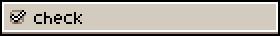

```lua
local dlg = Dialog()
dlg:check{ 
  id=string,
  label=string,
  text=string,
  selected=boolean,
  onclick=function
}
```

Creates a check box. Arguments are the same as in [Dialog:button](#dialogbutton).

## Dialog:close()

```lua
local dlg = Dialog()
dlg:button{ 
  text="Close",
  onclick=function()
    dlg:close()
  end
}
dlg:show{ wait=false }
```

Closes the dialog from a `onclick` [button](#dialogbutton) event. By
default, buttons without an `onclick` event handler will close the
dialog, but if you specify a `onclick` function, you have to call this
function to close the dialog.

## Dialog:color()

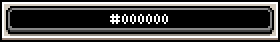

```lua
local dlg = Dialog()
dlg:color{ 
  id=string,
  label=string,
  color=Color,
  onchange=function
}
```

Creates a button to select a [color](color.md#color).

## Dialog:combobox()

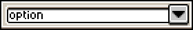

```lua
local dlg = Dialog()
dlg:combobox{
  id=string,
  label=string,
  option=string,
  options={ string1, string2, string3, ... },
  onchange=function
}
```

Creates a combo-box/dropdown list.

* `options`: Indicates a list of available options in the combobox.
* `option`: Indicates the default selected option in the combobox (one of the `options`).

## Dialog:entry()

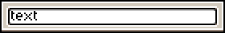

```lua
local dlg = Dialog()
dlg:entry{
  id=string,
  label=string,
  text=string,
  placeholder=string,
  focus=boolean,
  onchange=function
}
```

Creates a text entry. The `placeholder` property is a string to show as a placeholder when the entry is empty.

## Dialog:label()

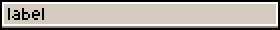

```lua
local dlg = Dialog()
dlg:label{
  id=string,
  label=string,
  text=string
}
```

* `id`: Identifier for this label. If you specify it, a field in
  [Dialog.data](#dialogdata) will be created with the given string in
  `text`.
* `label`: Text to be used in the left side.
* `text`: Text to be used in the right side.

Creates a static label. Text wrapping is not supported.

## Dialog:menuItem()

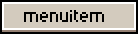

```lua
local dlg = Dialog()
dlg:menuItem{
  id=string,
  text=string,
  selected=boolean,
  onclick=function
}
```

Creates a new menu item (just like a menu item in a [menu bar menu](https://www.aseprite.org/docs/menu-bar#menu-bar)). Menu items are intended to be used with [Dialog:showMenu()](#dialogshowmenu); if used on a regular dialog, some things (like the onclick function) will not work. When a menu item is clicked, it will close the dialog (provided it was shown with Dialog:showMenu(), otherwise it won't do anything).

## Dialog:modify()

```lua
local dlg = Dialog()
dlg:modify{
  id=string,
  ...
  }
```

Changes properties of the given widget that matches the identifier `id`. For example, doing:

```lua
dlg:modify{ id="btn", visible="false" }
```
will modify the `btn` widget's `visible` property.

Using the `dialog:modify` with a parameter `title` changes the dialog title:

```lua
local dlg = Dialog()
dlg:modify{ title = "New Dialog Title" }
```

## Dialog:newrow()

```lua
local dlg = Dialog()
dlg:newrow()
dlg:newrow{ always=true }
```

Indicates that the next widget should be put in a new row in the
dialog (useful to create buttons or several controls of the same type
one below the other).

Using `newrow{ always=true }` is a way to avoid joining widgets of the
same type (it's like calling `newrow()` after each new widget is added).

## Dialog:number()

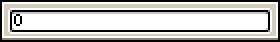

```lua
local dlg = Dialog()
dlg:number{
  id=string,
  label=string,
  text=string,
  decimals=integer,
  onchange=function
}
```

Creates an entry field to input a number. The `decimals` property, an integer, indicates how many decimal places a valid number should have.

## Dialog:radio()

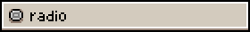

```lua
local dlg = Dialog()
dlg:radio{
  id=string,
  label=string,
  text=string,
  selected=boolean,
  onclick=function
}
```

Creates a radio button. Arguments are the same as in [Dialog:button](#dialogbutton).

Radio buttons group with the last labeled radio widget; for example:

```lua
dlg:radio{ text="1", label="Group 1"}
dlg:radio{ text="2" } -- Groups with group 1

dlg:radio{ text="3", label="Group 2"}
dlg:radio{ text="4" } -- Groups with group 2
dlg:radio{ text="5" } -- Groups with group 2
```

## Dialog:samerow()

```lua
local dlg = Dialog()
dlg:samerow()
dlg:samerow{ always=true }
```

Indicates that the next widget should be put in the same row as the previous widget 
(useful to put widgets of different types
next to eachother).

Using `samerow{ always=true }` will make each succeeding widget stay in the same row.

## Dialog:separator()

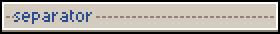

```lua
local dlg = Dialog()
dlg:separator{
  id=string,
  text=string
}
```

Creates a separator to separate widgets. The `text` property will display as the separator's title.

## Dialog:shades()

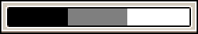

```lua
local dlg = Dialog()
dlg:shades{
  id=string,
  label=string,
  mode="pick" | "sort",
  colors={ color1, color2, color3, ... },
  onclick=function
}
```

Creates a widget with a set of colors that can be clicked/picked (when
`mode="pick"`, which is the default mode) or can be sorted (when
`mode="sort"`).

The `onclick` function can receive a `event` parameter which is a
table with a `color` field which is the color that was
clicked, and a `button` field with the
[mouse button](mousebutton.md#mousebutton), for example:

```lua
dlg:shades{
  ...
  onclick=function(ev)
    if ev.button == MouseButton.LEFT then
      -- In this case we change the active foreground color
      -- with the clicked color in the shades widget when
      -- the left mouse button is pressed.
      app.fgColor = ev.color
    elseif ev.button == MouseButton.RIGHT then
      app.bgColor = ev.color
    end
  end
}
```

## Dialog:show()

```lua
local dlg = Dialog()
dlg:show()
dlg:show{
  wait=false,
  bounds=Rectangle(),
  autoscrollbars=false,
  hand=false
}
```

Makes the dialog visible to the user. The script code will continue
when the dialog is closed by default (pressing a
[button](#dialogbutton)).

If `{ wait=false }` is used as an argument, the dialog is opened "in the
background", which means that the script code continues execution
with its following line, and the dialog will be visible until it's
closed with some button or calling [Dialog:close](#dialogclose) in an
`onclick` event.

With `{ bounds=Rectangle() }` you can display the dialog in a specific
location. Useful to show the dialog in a previous position that you
obtain from [Dialog.bounds](#dialogbounds) property.

Setting `{ autoscrollbars=true }` will add scrollbars automatically only
if they are needed. This means that if your dialog contains enough widgets
to make it go out of the window/screen (depending on whether you are using single
window UI or multiple windows UI) then scrollbars will be shown in your
dialog when its content doesn't fit its bounds.

If `{ hand=true }`, this enables the hand tool in the editor while the dialog is active. See the *Edit > Replace Color* menu for an example. Only useful if `{ wait=true }`.

## Dialog:showMenu()

```lua
local dlg = Dialog()
dlg:showMenu()
dlg:showMenu{
  position=Point
}
```

Shows the dialog as a menu (just like a menu in the [menu bar](https://www.aseprite.org/docs/menu-bar#menu-bar)). Mainly intended to be used with the [Dialog:menuItem()](#dialogmenuitem) widget, but it can be used with other widgets as well. If `position`, a [Point](point.md#point), is specified, it will show the menu at that position; otherwise it will show it at the current mouse position.

If the menu is unfocused (e.g the user clicks outside of the menu), the menu will close.

Widget labels are not shown when using Dialog:showMenu().


## Dialog:slider()

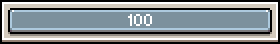

```lua
local dlg = Dialog()
dlg:slider{
  id=string,
  label=string,
  min=integer,
  max=integer,
  value=integer,
  onchange=function,
  onrelease=function
}
```

Creates a slider in the dialog.

## Dialog:tab()

```lua
local dlg = Dialog()
dlg:tab{
  id=string,
  text=string,
  onclick=function(ev) ... end
}
```

If called for the first time (or anytime after a
[Dialog:endtabs](#dialogendtabs) call), it creates a new tab group and starts
the first tab.
If called after a previous `Dialog:tab` call, it marks the end of the previous
tab group and starts a new one.

Once a tab is started, you can define its content by adding widgets as usual. When
you are done adding tabs, call [Dialog:endtabs](#dialogendtabs).

* `id`: Identifier for this tab. If you specify it, you can use it in
  [Dialog:endtabs](#dialogendtabs) to reference the selected tab. This value
  will be used also when asking for the selected tab through
  [Dialog.data](#dialogdata).
* `text`: Text to display on the tab.
* `onclick`: Function to be called when the tab is pressed. It receives a table
  parameter with the `tab` property, which you can use to get the pressed tab:
    ```lua
    { onclick=function(ev)
         print("pressed tab: " .. ev.tab)
      end }
    ```
Does not support the following common properties: `label`, `hexpand`, `vexpand`.
These can be specified at [Dialog:endtabs](#dialogendtabs).

## Dialog:endtabs()

```lua
local dlg = Dialog()
dlg:endtabs{
  id=string,
  selected=string,
  align=integer,
  onchange=function(ev) ... end
}
```

Marks the end of both the last tab and the group of tabs to which it belongs.

* `id`: Identifier for this tabs widget. [Dialog.data](#dialogdata)
  will contain a field named as this id, which will return the value
  of the currently selected tab's `id`.
* `align`: Horizontal and vertical alignment/placement of the tabs
  selector specified with [Align](align.md#align) values. Its default
  value is `{ align=Align.CENTER|Align.TOP }`.
* `onchange`: Function to be called when the tab is changed. It receives a table
  parameter with the `tab` property, which you can use to get the selected tab:
    ```lua
    { onchange=function(ev)
         print("selected tab: " .. ev.tab)
      end }
    ```

## Dialog:file()

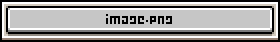

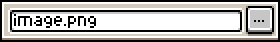

```lua
local dlg = Dialog()
dlg:file{ 
  id=string,
  title=string,
  filename=string,
  basepath=string,
  open=boolean,
  save=boolean,
  entry=boolean,
  filetypes={ string1,string2,string3... },
  onchange=function
}
```

Creates a text entry field + a button to select one file to open or save, with the following options:

* `open`: When true, shows a dialog to open an existing file (set to true by default).
* `save`: When true, shows a dialog to select an existing file to overwrite or a new file to save.

Other arguments:

* `filename`: String of the selected filename to open or save.
* `title`: The title of the file select menu.
* `filetypes`: Array of possible file types/extensions that the user can select.
* `entry`: Show an entry field to edit the filename manually (false by default).
* `basepath`: The base path of the directory. Use [app.fs.joinPath()](app_fs.md#appfsjoinpath) for paths.
* `onchange`: Function to be called when the filename/path is changed.

## Dialog:canvas()

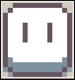

```lua
local dlg = Dialog()
dlg:canvas{
  id=string,
  width=integer,
  height=integer,
  autoscaling=boolean,
  onpaint=function(ev) ... end,
  onkeydown=function(ev) ... end,
  onkeyup=function(ev) ... end,
  onmousemove=function(ev) ... end,
  onmousedown=function(ev) ... end,
  onmouseup=function(ev) ... end,
  ondblclick=function(ev) ... end,
  onwheel=function(ev) ... end,
  ontouchmagnify=function(ev) ... end
}
```

The Canvas widget provides several events to create an interactive
experience with the user:

* `onpaint`: A function that receives an event with [a GraphicsContext
  (`ev.context`)](graphicscontext.md#graphicscontext) to paint on.
* `onkeydown`/`onkeyup`: Key events when a key is pressed or released.
  If a canvas widget handles these events, it will receive the
  keyboard focus when it's clicked. The `ev` event is a
  [KeyEvent](keyevent.md).
* `onmousemove`/`onmousedown`/`onmouseup`/`onwheel`/`ondblclick`: Mouse events when
  the mouse is moved over the canvas, a mouse button is pressed
  (`onmousedown`), a mouse button is double-clicked (`ondblclick`), a button is released (`onmouseup`), or the mouse wheel is moved (`onwheel`). The `ev` event is a
  [MouseEvent](mouseevent.md).
* `ontouchmagnify`: Touch event generated when a pinch gesture is done
  in the trackpad to zoom in or out. The `ev` event is a
  [TouchEvent](touchevent.md).

The `autoscaling` property allows the script developer to draw on the GraphicsContext
received in the canvas's onpaint event without worrying about the current UI scale
setting. For instance, you can draw a 20[px]x30[px] rectangle in the canvas's GraphicsContext and it
will be displayed the same at any UI scale. This property is enabled by default if omitted, so if
you don't need it you must explicitly set it to false.

```lua
dlg:modify{ id=canvasId, mousecursor=newMouseCursor }
```

Additionally, when using `Dialog:modify()`, the canvas `mousecursor` property can be set to a [MouseCursor](mousecursor.md) value, changing the mouse cursor type.

## Dialog:repaint()

```lua
dlg:repaint()
```

Will call `onpaint` event of all [canvases](#dialogcanvas) and update the
dialog pixels on the screen.
