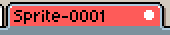

# Sprite

## Sprite()

```lua
local sprite = Sprite(width, height)
local sprite = Sprite(width, height, colorMode)
local sprite = Sprite(spec)
local sprite = Sprite(otherSprite)
local sprite = Sprite{ width=integer, height=integer}
local sprite = Sprite{ width=integer, height=integer, colorMode=ColorMode}
local sprite = Sprite{ fromFile=string }
local sprite = Sprite{ fromFile=string, oneFrame=true }
```

Creates a new sprite with the given `width` and `height`. The
[color mode](colormode.md#colormode) is optional, [RGB](colormode.md#colormodergb)
by default.

The `spec` parameter is an [image specification](imagespec.md#imagespec) object.

If `otherSprite` is given (other `Sprite` object), the sprite is duplicated.

If `fromFile` is given, it indicates a file name (a string); it's
like opening a new document with [`app.open()`](app.md#appopen).

When loading from a file, setting `oneFrame` to `true` will load the sprite with only the first animation frame.

## Sprite.width

```lua
local w = sprite.width
sprite.width = w
```

Gets or sets the sprite width. Use
[Sprite:resize()](#spriteresize) if you want to change the sprite size.

## Sprite.height

```lua
local h = sprite.height
sprite.height = h
```

Gets or sets the sprite height. Use
[Sprite:resize()](#spriteresize) if you want to change the sprite size.

## Sprite.bounds

```lua
local rectangle = sprite.bounds
```

Returns the bounds of the sprite as a
[rectangle](rectangle.md#rectangle) at the position `0,0`.
This is like calling `Rectangle{ x=0, y=0, width=sprite.width, height=sprite.height }`.

## Sprite.gridBounds

```lua
local rectangle = sprite.gridBounds
sprite.gridBounds = rectangle
```

Gets or sets the bounds of the sprite grid as a
[rectangle](rectangle.md#rectangle). By default, this is `16x16` (with its origin at `0,0`),
but the default value can be changed from [*Edit > Preferences > Grid*](https://www.aseprite.org/docs/preferences/).

## Sprite.pixelRatio

```lua
local size = sprite.pixelRatio
sprite.pixelRatio = size
```

Gets or sets the pixel aspect ratio of the sprite, as a
[size](size.md#size).

## Sprite.selection

```lua
local selection = sprite.selection
sprite.selection = newSelection
```

Gets or sets the active sprite selection, as a [Selection object](selection.md#selection). Note that this refers to the *selection* and not the selected content.

Keep in mind that `local selection = sprite.selection` will be a *reference* to the Sprite's selection, and will update when the Sprite's selection is changed or removed. To clone the selection, you can do the following:
```lua
local selection = Selection()
selection:add(sprite.selection)
```

## Sprite.filename

```lua
local name = sprite.filename
sprite.filename = newName
```

Gets or sets the filepath associated with the sprite (where the sprite is loaded from / saved to). If the sprite has no associated file, it will return the sprite title. See [Sprite.hasAssociatedFile](#spritehasassociatedfile).

## Sprite.id

```lua
local id = sprite.id
```

Returns the id of the sprite, as an integer.

## Sprite.isModified

```lua
local modified = sprite.isModified
```

Returns `true` if the sprite is modified compared to the latest saved
state on disk.

## Sprite.isValid

```lua
local valid = sprite.isValid
```

Returns `true` if the sprite object is a valid object (the sprite is open).

## Sprite.hasAssociatedFile

```lua
local associated = sprite.hasAssociatedFile
```

Returns `true` if the sprite was loaded from or saved to a file on the
disk.

## Sprite.colorSpace

```lua
local colorspace = sprite.colorSpace
sprite.colorSpace = colorspace
```

Gets or sets the [color space](colorspace.md#colorspace) of the sprite. Setting works the same as using [Sprite:assignColorSpace()](sprite.md#spriteassigncolorspace).

## Sprite.colorMode

```lua
local colormode = sprite.colormode
```

Returns the [color mode](colormode.md#colormode) of the sprite.

## Sprite.spec

```lua
local spec = sprite.spec
```

Returns the [image specification](imagespec.md#imagespec) of the sprite.

## Sprite.useLayerUuids

```lua
local layeruuids = sprite.useLayerUuids
sprite.useLayerUuids = layeruuids
```

Gets or sets if the sprite should use [layer UUIDs](layer.md#layeruuid).

## Sprite.undoHistory.undoSteps

```lua
local undosteps = sprite.undoHistory.undoSteps
```

Returns the amount of undo steps (steps before the current step), as an integer.

## Sprite.undoHistory.redoSteps

```lua
local redosteps = sprite.undoHistory.redoSteps
```

Returns the amount of redo steps (steps after the current step), as an integer.

## Sprite.frames

```lua
for i,frame in ipairs(s.frames) do
  -- ...
end
for i = 1,#s.frames do
  -- s.frames[i]
end
```

An array of the sprite's [frames](frame.md#frame).

## Sprite.palettes

```lua
local palette = sprite.palettes[1]
```

An array of the sprite's [palettes](palette.md#palette). In most cases, it only contains one
palette (`sprite.palettes[1]`), except in a very specific case:

In the event that two or more [indexed](https://www.aseprite.org/docs/color-mode#indexed) numbered
files (eg. `spr_01.png`, `spr_02.png`, `spr_03.png` etc.) are
[opened as a sequence](https://www.aseprite.org/docs/open#loading-image-sequences),
each frame would have its own palette. This only occurs when there are
at least two different indexed palettes, so the indexed palette for
the `spr_01.png` frame would have a different index-to-color mapping
than the indexed palette for `spr_02.png` (as would `spr_03.png`), hence
the need for three sprite palettes. If two images/frames have the same
indexed palette, they will share it (so if `spr_01.png` and `spr_02.png`
have the same palette, but `spr_03.png` has a different one, there
would be `2` sprite palettes).

There is no proper UI to support multiple palettes at the moment, but
in the future we want to create an easy way to create
[color cycling animations](https://en.wikipedia.org/wiki/Color_cycling).

## Sprite.layers

```lua
for i,layer in ipairs(s.layers) do
  -- ...
end
for i = 1,#s.layers do
  -- s.layers[i]
end
```

An array of the sprite's [layers](layer.md#layer), in ascending order.

## Sprite.cels

```lua
for i,cel in ipairs(s.cels) do
  -- ...
end
for i = 1,#s.cels do
  -- s.cels[i]
end
```

An array of the sprite's [cels](cel.md#cel), starting from the first (bottom) layer. Empty cels are not included.

## Sprite.tags

```lua
for i,tag in ipairs(s.tags) do
  -- ...
end
for i = 1,#s.tags do
  -- s.tags[i]
end
```

An array of the sprite's [tags](tag.md#tag).

## Sprite.slices

```lua
for i,slice in ipairs(s.slices) do
  -- ...
end
for i = 1,#s.slices do
  -- s.slices[i]
end
```

An array of the sprite's [slices](slice.md#slice).

## Sprite.tilesets

```lua
for i,tileset in ipairs(s.tilesets) do
  -- ...
end
for i = 1,#s.tilesets do
  -- s.tilesets[i]
end
```

An array of the sprite's [tilesets](tileset.md#tileset).

## Sprite.backgroundLayer

Returns the sprite's [background
layer](https://www.aseprite.org/docs/layers/#background-layer) (a
[layer](layer.md#layer) object). Returns `nil` if the sprite doesn't contain a
background layer.

## Sprite.transparentColor

```lua
local integer = sprite.transparentColor
sprite.transparentColor = integer
```

Gets or sets the sprite's transparent color index, as an integer. The transparent color index specifies which index in the palette (`0` by default) is the transparent color. The transparent color index is only in use when the sprite is in [indexed](colormode.md#colormodeindexed) mode. 

## Sprite.color

```lua
local color = sprite.color
sprite.color = color
```

Gets or sets the user-defined [color](color.md#color) of this sprite.
This color is used for the color of the sprite's tab in the tab bar.



## Sprite.data

```lua
local data = sprite.data
sprite.data = data
```

Gets or sets the user-defined data related to this sprite (a text string).

## Sprite.properties

Access user-defined and extension-defined
[properties](properties.md#properties) of this sprite.

## Sprite:resize()

```lua
sprite:resize(width, height)
sprite:resize(size)
```

Resize the sprite (and all frames/cels) to the given dimensions. See the
[Size class](size.md#size).

## Sprite:crop()

```lua
sprite:crop(x, y, width, height)
sprite:crop(rectangle)
```

Crops the sprite to the given dimensions. See the
[Rectangle class](rectangle.md#rectangle).

## Sprite:saveAs()

```lua
sprite:saveAs(filename)
```

Saves the sprite to the given `filename` (string path) and marks the sprite as saved so
closing it won't ask to save changes.

## Sprite:saveCopyAs()

```lua
sprite:saveCopyAs(filename)
```

Saves a copy of the sprite to the given file but does not change the
saved state of the sprite. If the sprite is then modified, the user
will be asked to save changes on close.

## Sprite:close()

```lua
sprite:close()
```

Closes the sprite. This does not ask the user to save changes. If you
want to do the classic *File > Close* where the user is asked to save
changes, you can use `app.command.CloseFile()`.

## Sprite:loadPalette()

```lua
sprite:loadPalette(filename)
```

Sets the sprite palette, loading it from the given file. If you want to set it to a [palette](palette.md#palette) object, use [`Sprite:setPalette()`](#spritesetpalette).

The same can be achieved using [`Palette{ fromFile }`](palette.md#palette):

```lua
sprite:setPalette(Palette{ fromFile=filename })
```

## Sprite:setPalette()

```lua
sprite:setPalette(palette)
```

Changes the sprite [palette](palette.md#palette). If you want to set the sprite palette from a file, use [`Sprite:loadPalette()`](#spriteloadpalette).

## Sprite:assignColorSpace()

```lua
local colorSpace = ColorSpace{ sRGB=true }
sprite:assignColorSpace(colorSpace)
```

Assigns a new [color space](colorspace.md#colorspace) to the sprite without
modifying the sprite pixels.

## Sprite:convertColorSpace()

```lua
local colorSpace = ColorSpace{ sRGB=true }
sprite:convertColorSpace(colorSpace)
```

Converts all the sprite pixels to a new [color space](colorspace.md#colorspace)
so the image looks the same as in the previous color space (all pixels
will be adjusted to the new color space).

## Sprite:newLayer()

```lua
local layer = sprite:newLayer()
```

Creates and returns a new [layer](layer.md#layer) at the top of the layer stack. For more layer creation options, like creating a reference layer, use [`app.command.NewLayer()`](command/NewLayer.md).

## Sprite:newGroup()

```lua
local layerGroup = sprite:newGroup()
```

Creates and returns a new empty [layer group](https://www.aseprite.org/docs/layer-group#layer-group) at the top of the layer stack.

## Sprite:deleteLayer()

```lua
sprite:deleteLayer(layer)
sprite:deleteLayer(layerName)
```

Deletes the given [`layer`](layer.md#layer) or the layer with the given `layerName` (a string). Also works for groups.

## Sprite:newFrame()

```lua
local frame = sprite:newFrame(frame)
local frame = sprite:newFrame(frameNumber)
```

Creates a copy of the given [`frame`](frame.md#frame) object (defaults to the last frame + 1) or frame number (an integer). If `frame` or `frameNumber` is specified, the copy is placed in the position of the original frame, so the original frame is shifted 1 frame to the right. Returns the newly created [frame](frame.md#frame) at the `frameNumber` position.

## Sprite:newEmptyFrame()

```lua
local frame = sprite:newEmptyFrame(frame)
local frame = sprite:newEmptyFrame(frameNumber)
```

Creates a new empty frame at the given [`frame`](frame.md#frame) or `frameNumber` (an integer) and
returns the new frame. The frame at the specified position is shifted to the right.

## Sprite:deleteFrame()

```lua
sprite:deleteFrame(frame)
sprite:deleteFrame(frameNumber)
```

Deletes the frame at the specified [`frame`](frame.md#frame) or `frameNumber` (an integer). Defaults to the first frame.

## Sprite:newCel()

```lua
cel = sprite:newCel(layer, frame)
cel = sprite:newCel(layer, frameNumber)
cel = sprite:newCel(layer, frame, image, position)
cel = sprite:newCel(layer, frameNumber, image, position)
```

Creates and returns a new [cel](cel.md#cel) at the intersection of the given [`layer`](layer.md#layer) and [`frame`](frame.md#frame)/`frameNumber`. If the [`image`](image.md#image) is not specified, a new image will be
created with the size of the sprite canvas. The `position`
is a [point](point.md#point) to locate the image.

## Sprite:deleteCel()

```lua
sprite:deleteCel(cel)
sprite:deleteCel(layer, frame)
```

Deletes the given [`cel`](cel.md#cel). If the cel is from a transparent
layer, the cel is completely deleted, but if the cel is from a
background layer, the cel will be deleted with the
[background color](app.md#appbgcolor).

## Sprite:newTag()

```lua
local tag = sprite:newTag(fromFrameNumber, toFrameNumber)
```

Creates and returns a new [tag](tag.md#tag) in the given frame range.

## Sprite:deleteTag()

```lua
sprite:deleteTag(tag)
sprite:deleteTag(tagName)
```

Deletes the given [tag](tag.md#tag).

## Sprite:newSlice()

```lua
local slice = sprite:newSlice()
local slice = sprite:newSlice(bounds)
```
Creates and returns a new [slice](slice.md#slice), with optional `bounds` (a [Rectangle](rectangle.md#rectangle)). If `bounds` is not specified, the slice will be created with no bounds (`nil`).

## Sprite:deleteSlice()

```lua
sprite:deleteSlice(slice)
sprite:deleteSlice(sliceName)
```

Deletes the given [slice](slice.md#slice).

## Sprite:newTileset()

```lua
local tileset = sprite:newTileset()
local tileset = sprite:newTileset(grid)
local tileset = sprite:newTileset(rectangle)
local tileset = sprite:newTileset(grid, numTiles)
local tileset = sprite:newTileset(rectangle, numTiles)
local tileset = sprite:newTileset(anotherTileset)
```

Returns a new [tileset](tileset.md#tileset) and adds it to the
sprite's tilesets.

If no parameters are given, the resulting tileset will have only one
empty tile and a tile size equal to the active [sprite grid size](#spritegridbounds).

If [`grid`](grid.md#grid) or [`rectangle`](rectangle.md#rectangle) is specified, it will be used to set the resulting
tileset's origin and tile size.

`numTiles`, an integer, specifies the number of tiles that the tileset will initially contain.

If `anotherTileset`, a [tileset](tileset.md#tileset), is passed as the only parameter, the result will be a
duplicate of the passed tileset. Take into consideration that the passed tileset
cannot belong to another sprite.

## Sprite:deleteTileset()

```lua
sprite:deleteTileset(tileset)
sprite:deleteTileset(tilesetIndex)
```

Deletes the given [tileset](tileset.md#tileset) from the sprite's tilesets.

## Sprite:newTile()

```lua
local tile = sprite:newTile(tileset [, tileIndex])
```

Inserts an empty [tile](tile.md#tile) into the given
[tileset](https://github.com/aseprite/api/blob/next-version/api/tileset.md#tileset)
at a given `tileIndex`. If `tileIndex` is not provided, the new tile
is added to the end of the tileset. This method generates undo
information, so you could use it as an individual operation or in a
[transaction](https://github.com/aseprite/api/blob/main/api/app.md#apptransaction). Returns a [tile](tile.md#tile) object.

## Sprite:deleteTile()

```lua
local tile = tileset:tile(tileIndex)
Sprite:deleteTile(tile)
Sprite:deleteTile(tileset, tileIndex)
```

Removes a `tile` from a
[tileset](https://github.com/aseprite/api/blob/next-version/api/tileset.md#tileset). This
method generates undo information, so you could use it as an
individual operation or in a
[transaction](https://github.com/aseprite/api/blob/main/api/app.md#apptransaction).

## Sprite:flatten()

```lua
sprite:flatten()
```

Flattens all layers of the sprite into one layer.
The same as calling `app.command.FlattenLayers()`.

## Sprite.events

Returns the [events](events.md#events) object to associate functions
that can act like listeners of specific sprite events. E.g.

```lua
sprite.events:on('change',
  function(ev)
    print('The sprite has changed')
  end)
```

A special `ev` argument can be sent to the listener. Which generally
is a table, but it can be `nil` for older version of Aseprite or
events that don't support it.

Available events for a `Sprite`:

* `'change'`: When the sprite content changes because an action is performed on it (also called when those actions are undone/redone). Since Aseprite v1.2.41, you can access `ev.fromUndo` property which is `true` if the change came from a undo/redo/undo history event (and not from a direct user change in the sprite).
* `'filenamechange'`: When the filename associated to a sprite changes.
* `'layerblendmode'`: The blend mode of a layer is changed.
* `'layername'`: The name of a layer is changed.
* `'layeropacity'`: The opacity of a layer is changed.
* `'layervisibility'`: The visibility of a layer is changed.
* `save`: The sprite is saved.
* `beforesave`: Before the sprite is saved.

## Sprite.tileManagementPlugin

```lua
local id = sprite.tileManagementPlugin
sprite.tileManagementPlugin = newId
```

Special property to disable Aseprite
[tile management UI](https://aseprite.org/docs/tilemap) and use
an external plugin to handle tilesets and tilemaps in the sprite.

This property is used by the
[Attachment-System](https://github.com/aseprite/Attachment-System)
plugin, but any extension can create a totally customized way to
handle tiles (and disable the standard UI to avoid conflicts).

**Warning**: If a sprite has this property set, another plugin
shouldn't change it, because it might break the tilesets/tilemaps
structure.
